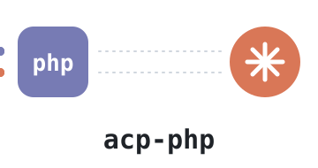

<p align="center"></p>

**Drive any ACP coding agent from PHP, like an editor does: Claude Code, Gemini CLI, Codex…**

Running a coding agent headless from PHP usually means its own CLI and its own output format. With Claude Code:

```php
$process = proc_open(
    ['claude', '-p', $prompt, '--output-format', 'stream-json', '--verbose', '--dangerously-skip-permissions'],
    [1 => ['pipe', 'w'], 2 => ['pipe', 'w']],
    $pipes,
);

while (($line = fgets($pipes[1])) !== false) {
    $event = json_decode($line, true);
    // Claude's own event format: guess the shapes, follow their changes.
}
```

A process per prompt, unless you stream its input as JSON too. A stream of untyped JSON to decode. And permissions decided before the agent even starts: skip them all, or list the allowed tools upfront. Answering a permission when the agent asks for it means building an MCP permission tool. Switch to another agent, and all of it changes.

acp-php speaks the [Agent Client Protocol](https://agentclientprotocol.com) (ACP), the protocol editors such as Zed use to drive coding agents: one typed protocol, whatever the agent. Here with Claude Code:

```php
use Acp\AgentProcess;
use Acp\Client\Permission\{CallbackPermissions, Outcome};
use Acp\Schema\{RequestPermissionRequest, SessionUpdate, ToolKind};

$agent = AgentProcess::start('claude-agent-acp', cwd: '/path/to/project');

$client = $agent->connect(permissions: new CallbackPermissions(
    fn (RequestPermissionRequest $request) => match ($request->toolCall->kind) {
        ToolKind::Read, ToolKind::Search => Outcome::approve($request),
        ToolKind::Edit => Outcome::approve($request),
        ToolKind::Execute, ToolKind::Fetch => Outcome::reject($request),
        default => Outcome::reject($request),
    },
));
$client->initialize();

$turn = $client->newSession()->prompt('Fix the failing test');

foreach ($turn->updates() as $update) {
    if ($update instanceof SessionUpdate\ToolCall) {
        echo "→ {$update->title}\n";
    }
}

echo $turn->text();
$agent->stop();
```

## What you get

- **Permissions decided live.** The agent asks before it edits or runs something, your code answers: a policy, a human on Slack, a CI rule.
- **A typed stream.** Tool calls, plans and messages arrive as PHP objects, not JSON to guess.
- **Sessions that last.** Several prompts in one conversation, cancel a turn, resume a session later.
- **Files under control.** Serve the agent's reads and writes yourself, confined to a directory.
- **Testable.** `FakeAgent` plays the agent in your tests: no API key, no network.

## Install

```bash
composer require degraciamathieu/acp-php
```

Then install an agent that speaks ACP.

## Agents

acp-php drives any agent that implements ACP: `AgentProcess::start()` takes the command that runs it, and its arguments.

- **Claude Code**, validated: `npm i -g @agentclientprotocol/claude-agent-acp`, then start `claude-agent-acp`. It uses your Claude Code login: start the agent with `env: ['ANTHROPIC_API_KEY' => null]` to keep it off API billing.
- **Other agents**, not validated yet: Gemini CLI, Codex CLI, GitHub Copilot, Goose, OpenCode… see the [list of ACP agents](https://agentclientprotocol.com/get-started/agents) for how to run each one.

## Test without an agent

```php
use Acp\Testing\{FakeAgent, FakeTurn};

$client = FakeAgent::create()
    ->onPrompt(fn (FakeTurn $turn) => $turn->say('All green.'))
    ->connect();
```

## Learn more

- [Driving an agent](docs/client.md): turns, permissions, files, sessions, errors, debugging
- [Testing your client](docs/testing.md)
- [The schema layer](docs/schema.md)
- [Examples](examples/)
- [Contributing](docs/contributing.md): roadmap and development

> **Early work in progress (0.1.0-dev).** Validated against `claude-agent-acp` 0.112.0. The API may still change.

## License

MIT
